# Garden Dreams — UI/UX audit 18/10/2026

Nguồn: https://garden-dreams-florist.vercel.app/ · múi giờ Asia/Saigon.

28 ảnh chụp production bằng Chromium: desktop 1440×900, mobile 390×844 và màn hình thấp 320×568. Ảnh 26–28 là toàn trang; các ảnh còn lại ghi nhận từng viewport hoặc modal.

Phạm vi: storefront công khai, giỏ hoa cục bộ, cổng khách/đăng nhập trước khi gửi biểu mẫu, Vườn kỷ niệm và thiệp công khai. Không đăng nhập admin, không tạo tài khoản/đơn/thanh toán, không đọc dữ liệu khách riêng. 40 thiệp đang hiển thị là gợi ý do Garden Dreams viết, không được coi là bằng chứng của 40 đơn thật.

20 mục dưới đây được đối chiếu với các issue mở #10, #17–#25. Lỗi tái hiện được và đề xuất được ghi riêng; đây là tài liệu audit, chưa sửa giao diện.

| Mã | Ưu tiên | Loại | Nội dung | Ảnh |
|---|---|---|---|---|
| UX-01 | P2 | Cải tiến bố cục | Thu gọn header mobile khi cuộn, dành thêm chỗ cho nội dung | [23](23-header-small-mobile.jpg), [05](05-catalog-mobile.jpg) |
| UX-02 | P3 | Cải tiến khả năng nhận biết | Bổ sung nhãn nhìn thấy cho icon tài khoản và hoa yêu thích | [01](01-home-desktop.jpg), [04](04-home-mobile.jpg) |
| UX-03 | P2 | Cải tiến điều hướng | Làm rõ danh sách dịp tặng có thể cuộn ngang trên mobile | [05](05-catalog-mobile.jpg) |
| UX-04 | P3 | Cải tiến phản hồi kết quả | Phân biệt số hoa đang hiển thị với tổng số kết quả phù hợp | [02](02-catalog-desktop.jpg), [05](05-catalog-mobile.jpg) |
| UX-05 | P2 | Lỗi đã tái hiện | Sửa nút Xem tất cả hoa không xóa bộ lọc màu và loại hoa | [12](12-empty-before-reset.jpg), [13](13-empty-after-reset.jpg) |
| UX-06 | P2 | Cải tiến khả năng sửa bộ lọc | Hiện chip các bộ lọc đang áp dụng khi đóng bảng lọc | [14](14-filter-active-collapsed.jpg) |
| UX-07 | P2 | Cải tiến tính liên tục | Giữ bộ lọc và sắp xếp khi tải lại hoặc chia sẻ bộ sưu tập | [14](14-filter-active-collapsed.jpg), [15](15-filter-lost-after-reload.jpg) |
| UX-08 | P2 | Cải tiến bố cục chi tiết | Ưu tiên thông tin bó hoa trong modal mobile thay vì ảnh và footer quá cao | [06](06-product-mobile.jpg) |
| UX-09 | P2 | Cải tiến ngõ cụt sản phẩm | Thêm bước tiếp theo hữu ích cho mẫu hoa chưa nhận đặt | [16](16-unavailable-product.jpg) |
| UX-10 | P2 | Cải tiến kiểm tra giỏ hoa | Cho mở lại chi tiết sản phẩm trực tiếp từ giỏ hoa | [07](07-cart-mobile.jpg) |
| UX-11 | P3 | Cải tiến khả năng hoàn tác | Cho hoàn tác khi xóa một dòng khỏi giỏ hoa | [07](07-cart-mobile.jpg), [17](17-cart-removed-mobile.jpg) |
| UX-12 | P2 | Cải tiến ngữ cảnh checkout | Hiện tóm tắt bó hoa và tạm tính ngay tại bước chọn khách/đăng nhập | [08](08-checkout-mobile.jpg), [09](09-account-login-mobile.jpg) |
| UX-13 | P2 | Cải tiến hướng dẫn phiên khách | Làm rõ cách xem lại đơn khi tiếp tục bằng phiên khách | [08](08-checkout-mobile.jpg) |
| UX-14 | P2 | Cải tiến hướng dẫn biểu mẫu | Hiện yêu cầu mật khẩu tối thiểu 12 ký tự trước khi đăng ký | [25](25-signup-mobile.jpg), [10](10-account-signup-mobile.jpg) |
| UX-15 | P3 | Cải tiến duyệt danh sách dài | Đưa tìm kiếm và bộ lọc về trong tầm với khi cuộn danh sách hoa mobile | [24](24-catalog-scrolled-mobile.jpg) |
| UX-16 | P2 | Cải tiến khám phá Vườn kỷ niệm | Thêm tìm kiếm hoặc lọc mục đích cho 40 gợi ý lời nhắn | [18](18-garden-mobile.jpg), [22](22-garden-desktop.jpg), [28](28-garden-full-desktop.jpg) |
| UX-17 | P2 | Lỗi đã tái hiện | Giữ số thiệp đã tải và vị trí cuộn khi quay lại Vườn kỷ niệm | [19](19-garden-loaded-40.jpg), [20](20-greeting-mobile.jpg), [21](21-garden-back-reset.jpg) |
| UX-18 | P2 | Cải tiến giá trị sử dụng của thiệp | Cho sao chép lời nhắn gợi ý để dùng trên thiệp hoa | [20](20-greeting-mobile.jpg) |
| UX-19 | P3 | Cải tiến chia sẻ thiệp công khai | Thêm chia sẻ hoặc sao chép đường dẫn cho từng thiệp công khai | [20](20-greeting-mobile.jpg) |
| UX-20 | P2 | Cải tiến khả năng nhìn thấy ô nhập | Tăng độ rõ của ranh giới ô nhập trên nền kem ở trang tài khoản | [25](25-signup-mobile.jpg), [05](05-catalog-mobile.jpg) |

## Ảnh chụp

Ảnh 09–11 là các chế độ tài khoản bên trong modal checkout, chưa gửi biểu mẫu. Ảnh 25 là đăng ký ở trang tài khoản riêng. Ảnh 12/13 so sánh trước/sau reset lỗi; 14/15 trước/sau tải lại; 19/21 cho thấy mất trạng thái danh sách thiệp.

### 01-home-desktop
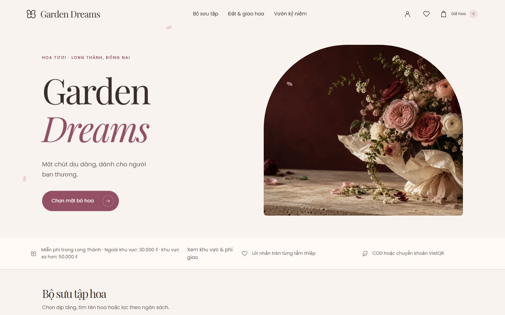

### 02-catalog-desktop
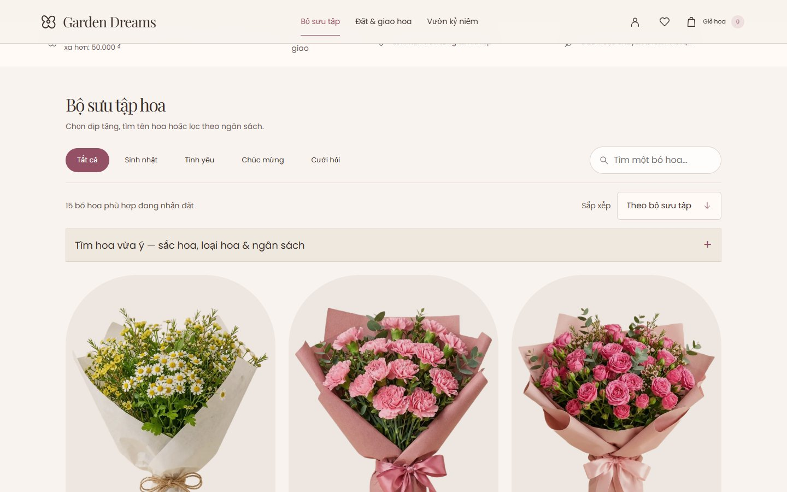

### 03-product-desktop
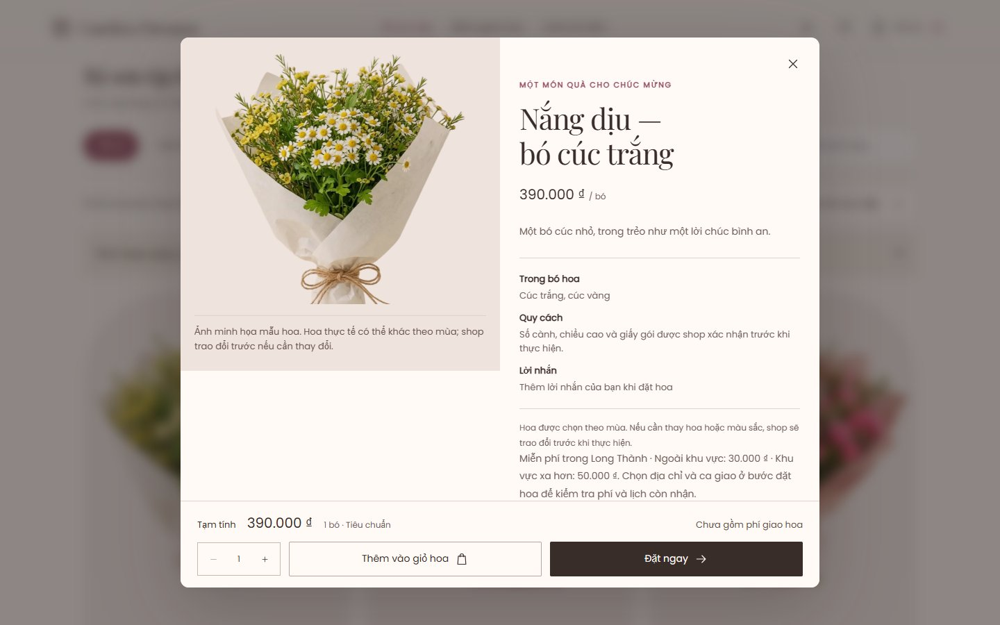

### 04-home-mobile
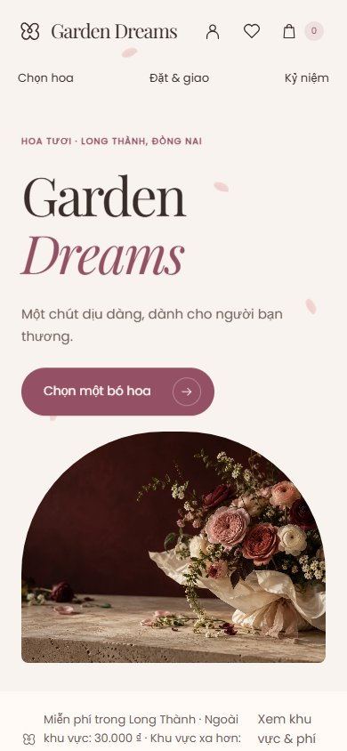

### 05-catalog-mobile
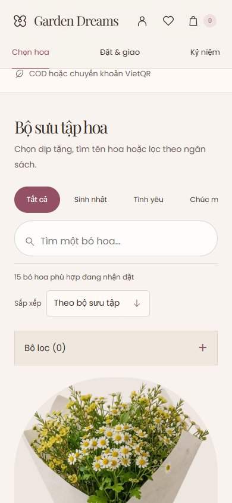

### 06-product-mobile
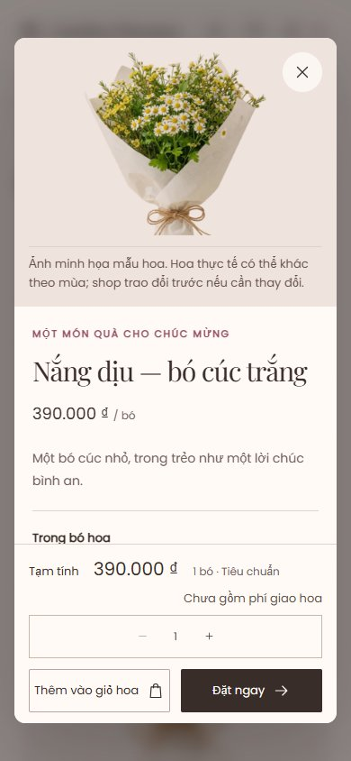

### 07-cart-mobile
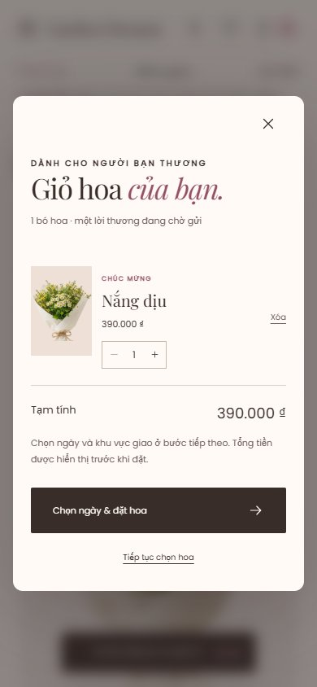

### 08-checkout-mobile
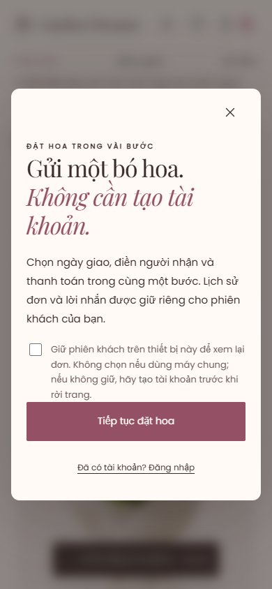

### 09-account-login-mobile
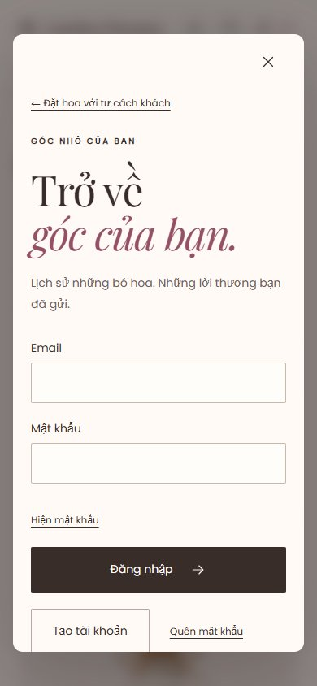

### 10-account-signup-mobile
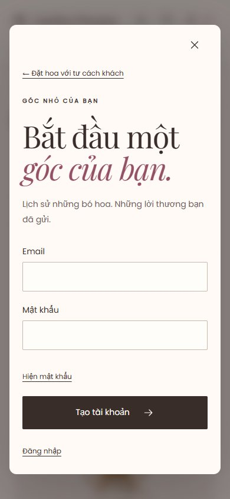

### 11-account-reset-mobile
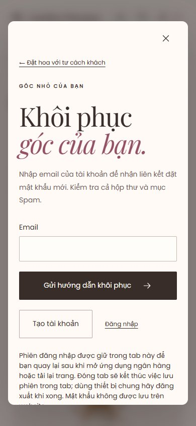

### 12-empty-before-reset
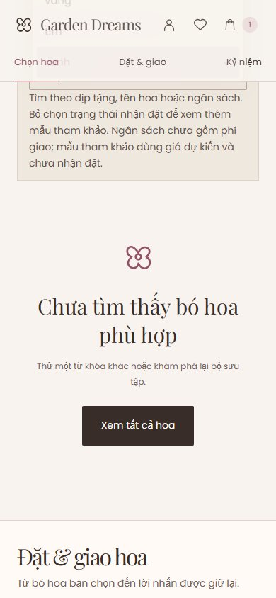

### 13-empty-after-reset
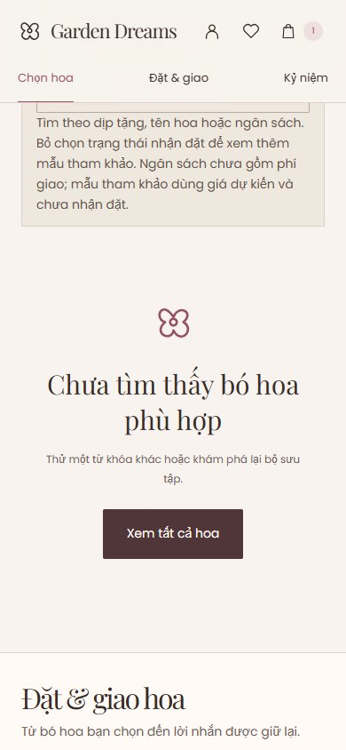

### 14-filter-active-collapsed
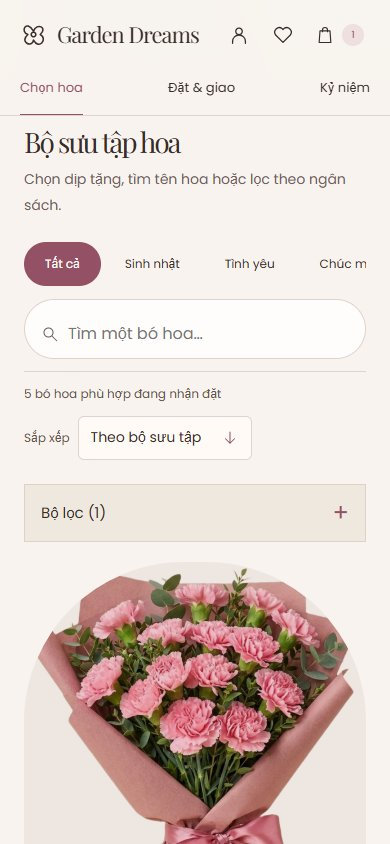

### 15-filter-lost-after-reload
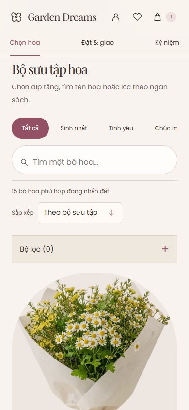

### 16-unavailable-product
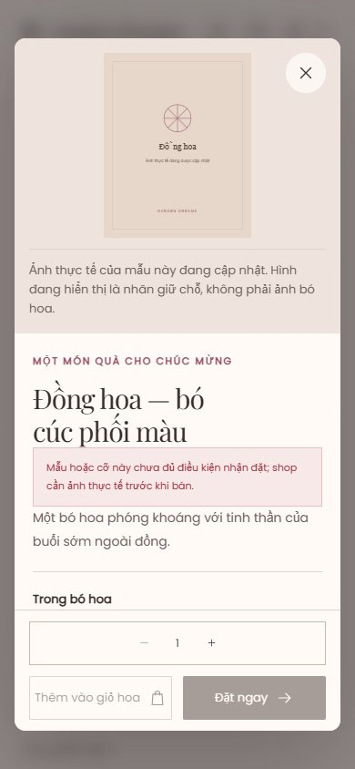

### 17-cart-removed-mobile

### 18-garden-mobile

### 19-garden-loaded-40
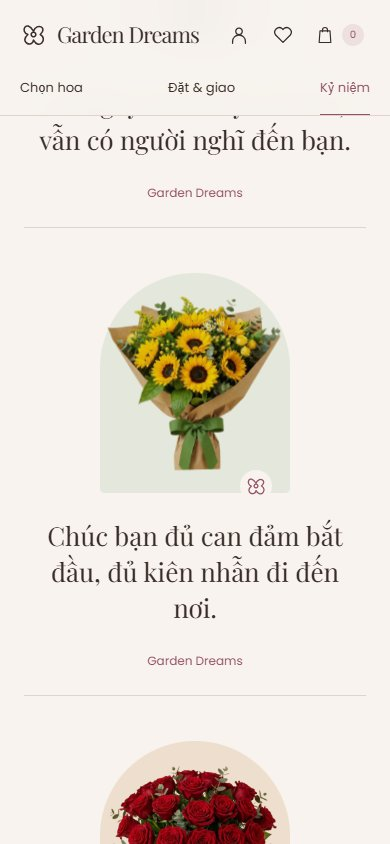

### 20-greeting-mobile
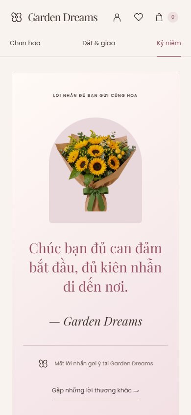

### 21-garden-back-reset

### 22-garden-desktop
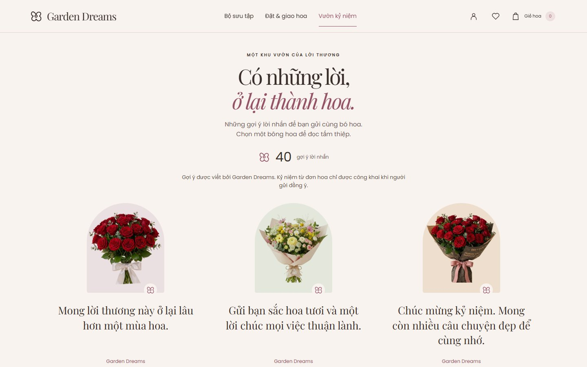

### 23-header-small-mobile
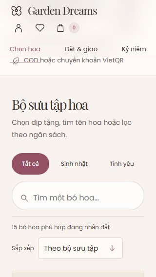

### 24-catalog-scrolled-mobile
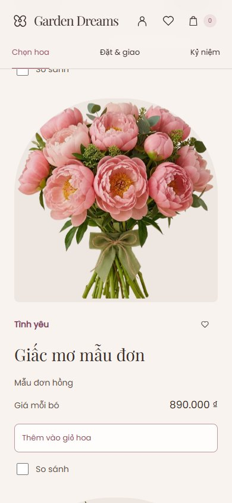

### 25-signup-mobile
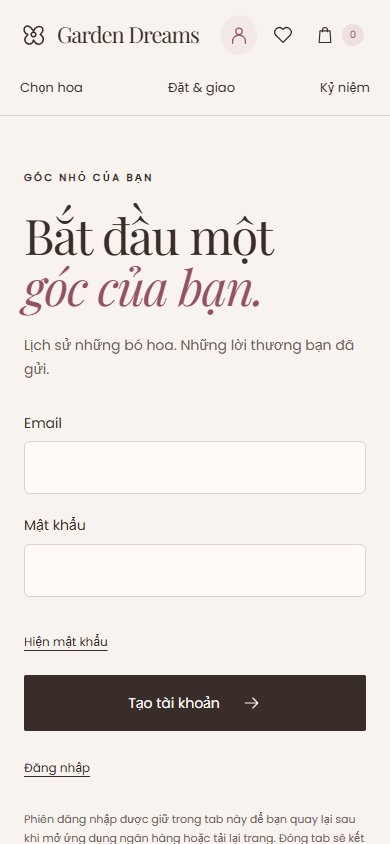

### 26-home-full-mobile
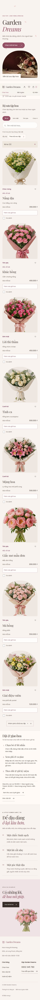

### 27-home-full-desktop
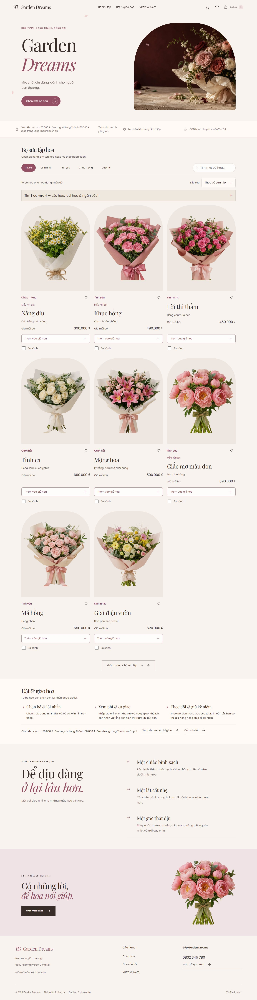

### 28-garden-full-desktop
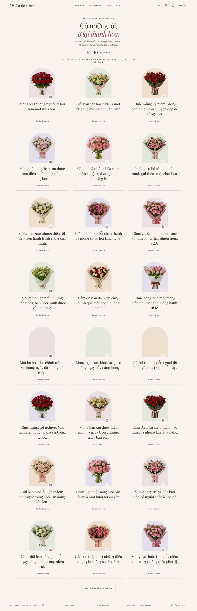
